# Laboratorio: planetas y estrellas con shaders

Sistema solar de fantasía dibujado con un **software renderer en CPU** escrito en Rust.
Todos los cuerpos usan **la misma esfera** (`assets/sphere.obj`, 98 vértices / 192 triángulos);
la apariencia sale exclusivamente de **fragment shaders procedurales** (ruido OpenSimplex2, ruido
celular/Voronoi, ondas, domain warping, máscaras e iluminación). No hay imágenes ni texturas externas.

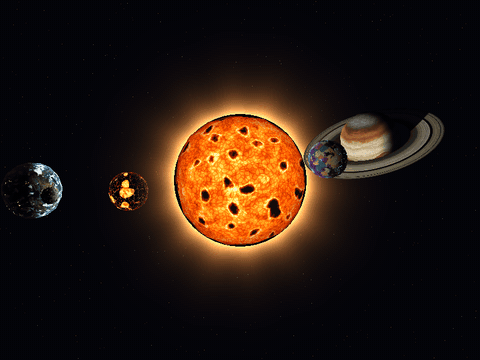

| Helios (estrella) | Terra Nova + Selene | Zephyr + anillos |
|:---:|:---:|:---:|
| 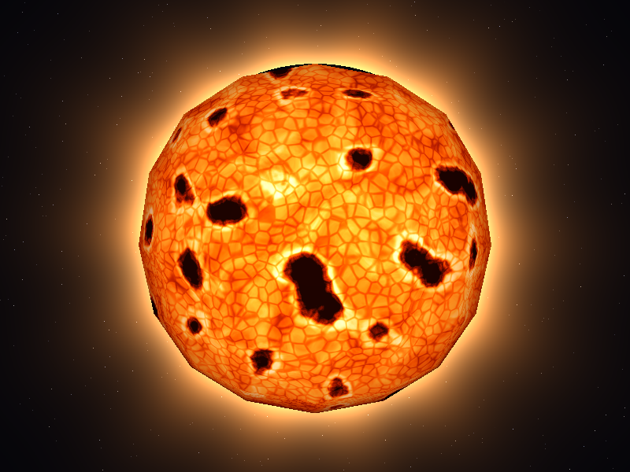 | 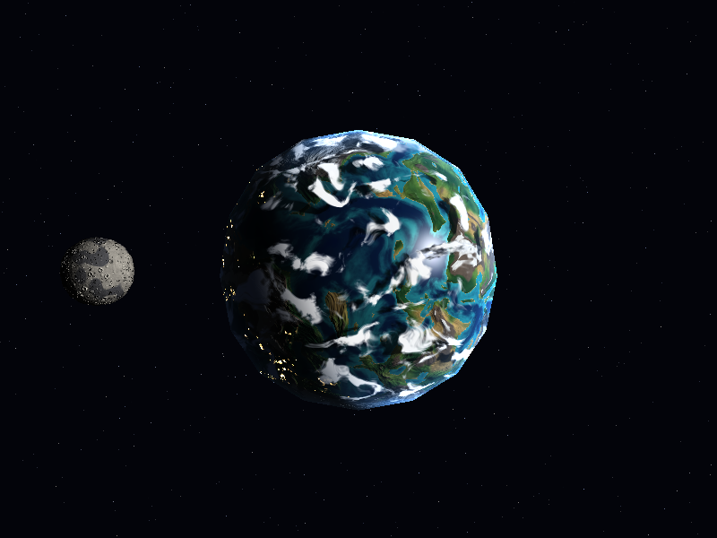 | 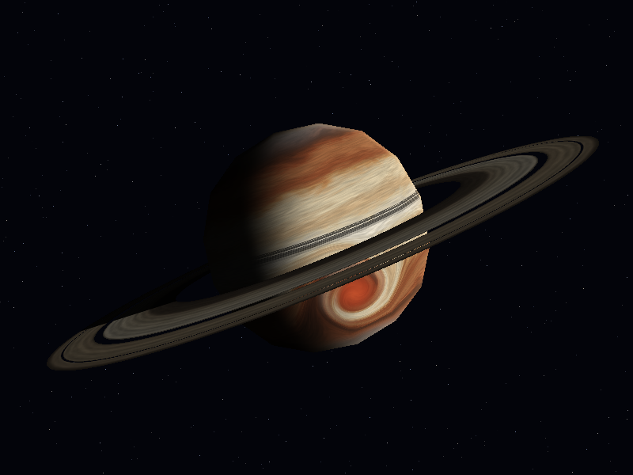 |
| **Ignis** (extra) | **Glacies** (extra) | **Nyx** (extra) |
| 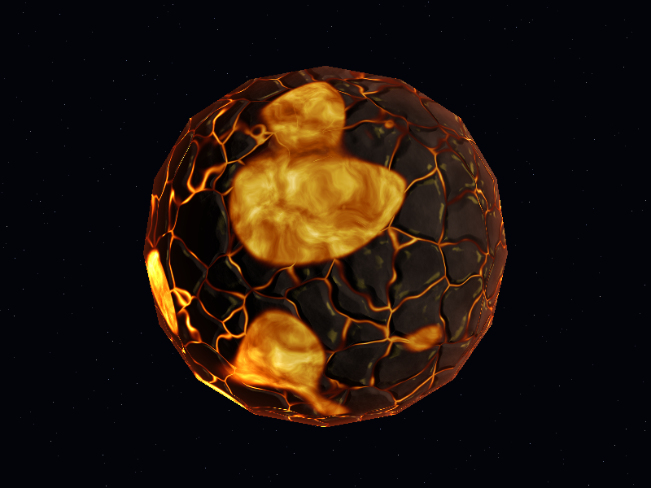 | 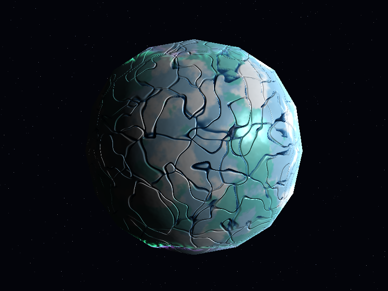 | 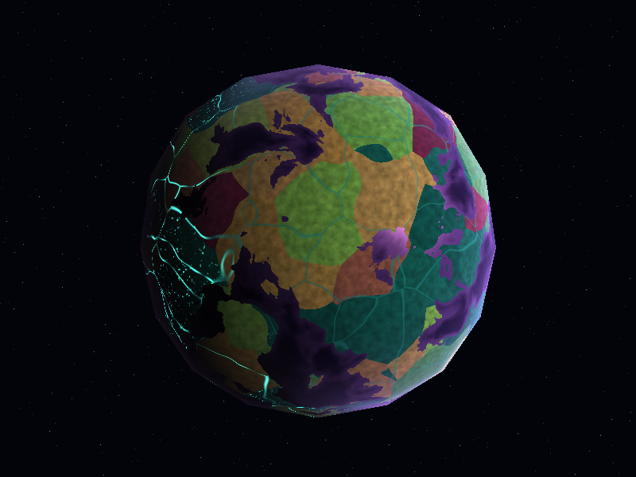 |

---

## Compilar y ejecutar

Requisitos:
- [Rust](https://rustup.rs/) (versión estable, probado con 1.97).
- **Windows:** instalar Rust con `rustup` y las *Build Tools* de Visual Studio (C++).
- **Linux:** librerías de X11 (`sudo apt install libx11-dev libxkbcommon-dev`).

```bash
git clone https://github.com/Gotkissss/Lab6-Graficas.git
cd Lab6-Graficas
cargo run --release
```

> Usa **`--release`**: el renderer corre en CPU y en modo release es varias veces más rápido
> (el sombreado por píxel se reparte entre todos los núcleos con `rayon`).

### Seleccionar el shader / controles

| Tecla | Acción |
|---|---|
| **1** | Helios — estrella |
| **2** | Terra Nova — planeta rocoso + su luna Selene |
| **3** | Zephyr — gigante gaseoso + sistema de anillos |
| **4** | Ignis — mundo de lava (extra) |
| **5** | Glacies — mundo de hielo (extra) |
| **6** | Nyx — mundo bioluminiscente (extra) |
| **0** | Sistema completo (todos a la vez, iluminados por Helios) |
| Tab | Siguiente vista |
| ← → ↑ ↓ / A D | Orbitar la cámara |
| W / S | Acercar / alejar |
| Z / X | Mover la luz (el "sol") alrededor del planeta |
| `[` / `]` | Cobertura de nubes − / + |
| C · H | Nubes on/off · sombras de nubes on/off |
| `-` / `=` · B | Fuerza del bump mapping · bump on/off |
| `,` / `.` · P | Escala del parallax · parallax on/off |
| N / M · T | Fuerza de la tormenta · tormenta on/off |
| L | Luces nocturnas (ciudades / bioluminiscencia) on/off |
| Espacio · R · Esc | Pausa · reiniciar vista · salir |

El título de la ventana muestra la vista actual, los FPS y el valor de los parámetros.

### Regenerar capturas y videos

```bash
cargo run --release -- --capture capture          # imágenes + cuadros de cada video
cargo run --release -- --capture capture stills   # solo imágenes
cargo run --release -- --capture capture only:anim_helios
```
Los GIF de `docs/gif` se armaron con `ffmpeg` a partir de esos cuadros.

---

## Cómo funciona el renderer

```
sphere.obj ──► vertex shader ──► matriz de modelo/vista/proyección ──► rasterización
                (shaders/mod.rs)          (render.rs::transform)        (baricéntricas, corrección
                                                                         de perspectiva, z-buffer)
                                                       │
       fondo + halo ◄── fragment shader por píxel ◄────┘
        (render.rs)       (shaders/*.rs, en paralelo)
```

| Archivo | Contenido |
|---|---|
| `src/main.rs` | ventana (minifb), teclado, estado y parámetros |
| `src/render.rs` | pipeline: vertex shader → rasterizador → z-buffer → fragment shaders; fondo estrellado y halo |
| `src/scene.rs` | instancias de **la misma esfera** (posición, radio, inclinación) para cada vista |
| `src/noise.rs` | generadores FastNoiseLite: OpenSimplex2 FBm, ruido celular (F1, F2−F1, valor de celda) |
| `src/shaders/common.rs` | `mix`, `smoothstep`, rampas de color, rotaciones, `bump_normal`, Blinn-Phong |
| `src/shaders/*.rs` | un archivo por cuerpo: `star`, `rocky`, `moon`, `gas`, `rings`, `lava`, `ice`, `nyx` |

Cada fragment shader recibe la dirección `p` del fragmento sobre la esfera (que también es su normal
suave), la dirección a la luz `l`, la dirección a la cámara `v` y el tiempo. Las constantes en
MAYÚSCULAS al inicio de cada archivo son los parámetros de apariencia; cámbialas y vuelve a ejecutar.

---

## Los cuerpos celestes

Cada cuerpo combina **4 o más capas de color** generadas por patrones distintos.

### 1. Helios — la estrella (`src/shaders/star.rs`)

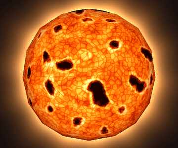

Una estrella naranja con superficie hirviente, celdas de convección y manchas solares. Es **emisiva**:
no usa la luz externa, su brillo sale solo de la temperatura.

| Capa | Patrón | Cómo se combina |
|---|---|---|
| 1. Temperatura base | FBm OpenSimplex con *domain warping* animado | define el valor `heat` principal |
| 2. Granulación | ruido celular F2−F1 a frecuencia alta | suma brillo en el centro de cada celda, bordes oscuros |
| 3. Manchas solares | OpenSimplex de baja frecuencia + filamentos (seno del ruido) | umbra y penumbra restan calor |
| 4. Fáculas | banda del mismo ruido justo antes de la mancha | suma calor alrededor de las manchas |
| 5. Limb darkening | `dot(p, v)` elevado a una potencia | oscurece y enrojece el borde |

El calor final se convierte en color con una **rampa de 7 paradas** (rojo oscuro → naranja → amarillo → blanco).
Además, `render.rs::background` dibuja un **halo/corona** alrededor de la estrella con rayos que giran.

**Parámetros:** `BOIL_SPEED` (velocidad del hervor), `GRANULE_FREQ` (tamaño de las celdas),
`SPOT_THRESHOLD` (más bajo ⇒ más manchas), `LIMB_POWER` (oscurecimiento del borde).

### 2. Terra Nova — planeta rocoso (`src/shaders/rocky.rs`) + Selene (`src/shaders/moon.rs`)


Planeta tipo Tierra con continentes, desiertos, cordilleras nevadas, casquetes polares, nubes que
viajan más rápido que el terreno y ciudades que se encienden de noche.

| Capa | Patrón | Cómo se combina |
|---|---|---|
| 1. Océano | altura bajo el nivel del mar + ruido de olas | `mix` entre azul turquesa y azul profundo según la profundidad |
| 2. Biomas | altura (FBm con domain warping + ruido *ridged*) y humedad (otro FBm) + latitud | playa → pasto/bosque/desierto → roca → nieve con `smoothstep` |
| 3. Hielo polar | latitud `|p.y|` perturbada con ruido | cubre tierra y mar |
| 4. Luces de ciudad | ruido de alta frecuencia × máscara de grupos | solo en tierra baja y **solo en el lado nocturno** |
| 5. Nubes | FBm estirado en latitud + domain warping, con umbral de cobertura | se mezclan sobre la superficie, rotan con otra velocidad |
| 6. Atmósfera | Fresnel `(1 − dot(p, v))^2.5` | resplandor azul en el borde iluminado |

**Parámetros:** `SEA_LEVEL` (subirlo inunda continentes), `CONTINENT_FREQ` (tamaño de continentes),
`SURFACE_SPIN` / `CLOUD_SPIN` (rotación del terreno y de las nubes), `CLOUD_HEIGHT` (separación de
las sombras), `OCEAN_SHININESS` (tamaño del brillo del mar), y en tiempo real `[`/`]` para la cobertura.

**Selene, la luna** — orbita a Terra Nova (es la misma esfera escalada al 27 %):

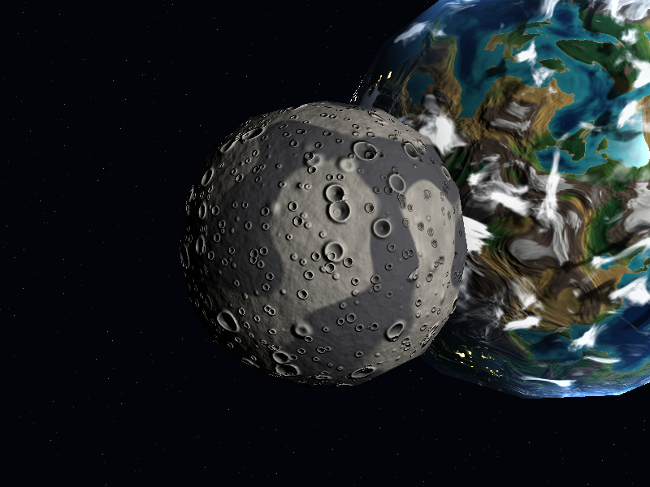

| Capa | Patrón |
|---|---|
| 1. Regolito | FBm gris cálido |
| 2. Mares de basalto | OpenSimplex de baja frecuencia con umbral |
| 3. Cráteres (2 escalas) | ruido celular F1: cuenco oscuro + borde claro (gaussiana) |
| 4. Rayos de eyecta | FBm anisotrópico claro |

Usa **bump mapping** del campo de altura de los cráteres. Parámetros: `CRATER_FREQ`,
`SMALL_CRATER_FREQ`, `MARIA_THRESHOLD`.

### 3. Zephyr — gigante gaseoso (`src/shaders/gas.rs`) + anillos (`src/shaders/rings.rs`)

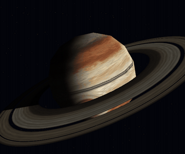

Bandas ocre/crema que fluyen como líquido en direcciones alternas y una gran tormenta que las
enrolla en espiral. Está inclinado 22° y tiene un sistema de anillos con divisiones.

| Capa | Patrón | Cómo se combina |
|---|---|---|
| 1. Familias de bandas | seno de la latitud distorsionada | elige el color en una rampa de 5 paradas |
| 2. Claro/oscuro + estrías | segundo seno + ruido muy estirado en longitud | modula el brillo dentro de cada banda |
| 3. Tormenta | vórtice (rotación local) + núcleo rojizo y anillo claro | curva las bandas y se mezcla con `mix` |
| 4. Bruma polar | latitud alta | desatura hacia azul grisáceo |
| 5. Sombra de anillos + bruma | rayo hacia la luz vs. plano del anillo; Fresnel | oscurece franjas / aclara el borde |

*Bandas líquidas:* cada latitud tiene su propia velocidad (`sin(lat·11)`), y la turbulencia se
"advecta" con la técnica de **flow map de dos fases** (dos muestras desfasadas que se mezclan), así el
ruido fluye sin estirarse infinitamente.

**Parámetros:** `BAND_COUNT`, `TURBULENCE` (ondulación de los bordes), `FLOW_SPEED`,
`STORM_LAT`, `STORM_RADIUS`; en tiempo real `N`/`M` (fuerza del giro de la tormenta).

**Anillos:** la **misma esfera** con una matriz de modelo de escala no uniforme (2.5× en XZ,
0.002× en Y): un disco delgado. El fragment shader:

| Capa | Patrón |
|---|---|
| 1. Anillo C interior | polvo oscuro y tenue |
| 2. Anillo B | hielo crema brillante |
| 3. Divisiones de Cassini y Encke | `smoothstep` sobre la distancia → **se descartan** (`discard`) |
| 4. Anillo A + ringlets | senos de alta frecuencia en el radio |
| 5. Grumos + sombra del planeta | ruido que orbita más rápido cerca del planeta (Kepler); intersección rayo-esfera hacia la luz |

Parámetros: `INNER`, `OUTER`, `CASSINI` en `rings.rs`.

### 4. Ignis — mundo de lava, extra (`src/shaders/lava.rs`)

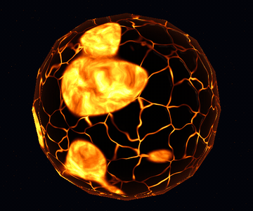

Corteza de basalto partida en placas, con grietas incandescentes, lagos de lava y azufre.

| Capa | Patrón |
|---|---|
| 1. Corteza | FBm oscuro (con bump) |
| 2. Grietas | ruido celular F2−F1 con domain warping: ~0 en el borde de cada placa |
| 3. Lagos de lava | OpenSimplex de baja frecuencia + turbulencia FBm que fluye |
| 4. Azufre | halo justo fuera de cada grieta × ruido |
| 5. Humo | Fresnel rojizo en el borde |

El calor pasa por una rampa (rojo oscuro → naranja → amarillo → blanco) y **pulsa** con el tiempo.
Parámetros: `CRACK_FREQ`, `CRACK_WIDTH`, `LAKE_THRESHOLD`, `PULSE_SPEED`.

### 5. Glacies — mundo de hielo, extra (`src/shaders/ice.rs`)


Glaciares y campos de nieve cruzados por grietas profundas, mares congelados y auroras polares.

| Capa | Patrón |
|---|---|
| 1. Nieve | FBm con umbral (blanco mate) |
| 2. Glaciares | azul hielo donde no hay nieve |
| 3. Mar congelado | FBm de baja frecuencia, turquesa |
| 4. Grietas (crevasses) | `|OpenSimplex|` (líneas de cruce por cero) + bordes Voronoi: azul profundo |
| 5. Auroras | gaussiana en latitud × cortina `sin(lon·28 + t)` |

Parámetros: `CREVASSE_FREQ`, `PARALLAX_STEPS`, `AURORA_LAT`; en tiempo real `,`/`.` (profundidad del parallax).

### 6. Nyx — mundo bioluminiscente, extra (`src/shaders/nyx.rs`)


Planeta alienígena de mares violeta y biomas en mosaico; de noche sus ríos y selvas brillan.

| Capa | Patrón |
|---|---|
| 1. Mares violeta | FBm, profundidad |
| 2. Biomas | **valor de celda Voronoi** → selva, hongos, esporas, arrecifes (rampa de 8 paradas) |
| 3. Ríos de luz | borde entre celdas (F2−F1) |
| 4. Bioluminiscencia | ondas `sin(t − distancia·18)` que recorren ríos y selvas de noche |
| 5. Bruma violeta | Fresnel |

Parámetros: `BIOME_FREQ`, `RIVER_WIDTH`, `GLOW_SPEED`.

---

## Efectos implementados (evidencia)

| Efecto | Cuerpo | Archivo · función | Evidencia |
|---|---|---|---|
| **Sistema de anillos** | Zephyr | `rings.rs::shade`, `rings.rs::density`, `mod.rs::discard`, `scene.rs::Instance::new` | `docs/img/zephyr.png` |
| **Luna en planeta rocoso** | Terra Nova | `moon.rs::shade`, `scene.rs::build` | `docs/img/selene.png` |
| Material animado | Helios, Zephyr, Ignis, Nyx, auroras | `star.rs::shade`, `gas.rs::liquid_turbulence`, `lava.rs::shade` | GIFs abajo |
| Día y noche | Terra Nova, Ignis, Nyx, Glacies | `rocky.rs::shade` (capa 4) | `docs/img/*_noche.png` |
| Respuestas diferentes a la luz | Terra Nova (también Glacies, Nyx) | `rocky.rs::shade` | `docs/gif/anim_terra_luz.gif` |
| Nubes procedurales | Terra Nova | `rocky.rs::cloud_density` | `docs/gif/anim_terra_nubes.gif`, `nubes_cobertura_*.png` |
| Tormenta / vórtice | Zephyr | `gas.rs::shade` (bloque "Vórtice") | `docs/gif/anim_tormenta.gif` |
| Bump mapping | Terra Nova, Selene, Ignis, Glacies | `common.rs::bump_normal` + `height()` de cada shader | `docs/img/bump_on_*.png` vs `bump_off_*.png` |
| Parallax | Glacies | `ice.rs::shade` (bloque "Parallax") | `docs/gif/anim_glacies_parallax.gif` |
| Sombras de nubes | Terra Nova | `rocky.rs::shade` (bloque "Sombras de nubes") | `docs/img/sombras_on.png` vs `sombras_off.png`, `anim_terra_luz.gif` |

### Sistema de anillos
La esfera se aplasta con una **matriz de escala** (no se modifican los vértices) y el fragment
shader calcula el radio `r` de cada fragmento. `density(r)` arma el perfil: borde interior y
exterior, anillo C tenue, divisiones de Cassini (`r≈1.93`) y Encke (`r≈2.2`) y *ringlets* con senos.
Donde la densidad es menor que 0.06 el fragmento se **descarta** durante la rasterización, así se ve el
planeta a través de los huecos. Los anillos reciben la **sombra del planeta** (intersección del rayo
hacia la luz con la esfera) y proyectan su **sombra sobre el planeta** (en `gas.rs`).
*Parámetro:* `CASSINI` mueve la división principal; `INNER`/`OUTER` cambian el ancho.

### Luna en el planeta rocoso
Selene es otra instancia de la misma esfera (radio 0.27) que orbita a Terra Nova
(`scene.rs::build`, `moon_at`). Su shader propio tiene cráteres celulares con bump mapping.
*Parámetro:* `CRATER_FREQ` (más alto ⇒ más cráteres y más pequeños).

### Material animado
| Helios | Ignis | Nyx (noche) |
|:---:|:---:|:---:|
|  |  | 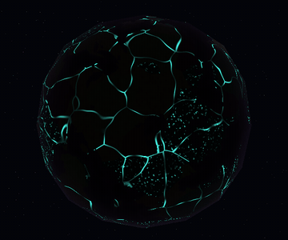 |

La geometría no se mueve: el tiempo entra en las coordenadas del ruido. En Helios la temperatura
"hierve" y la granulación se desplaza; en Ignis el calor de las grietas pulsa
(`0.72 + 0.28·sin(t·PULSE_SPEED + warp)`) y la lava de los lagos fluye; en Zephyr las bandas fluyen
(flow map) y la tormenta gira; en Glacies las auroras ondulan.
*Parámetro:* `PULSE_SPEED` en `lava.rs` (velocidad del latido), `BOIL_SPEED` en `star.rs`.

### Apariencia de día y noche
| Terra Nova | Ignis | Nyx | Glacies |
|:---:|:---:|:---:|:---:|
| 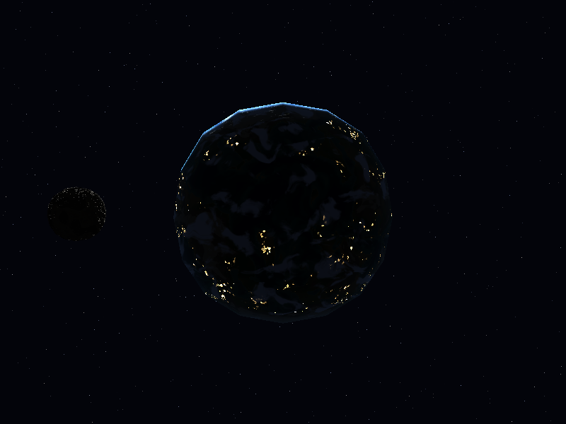 | 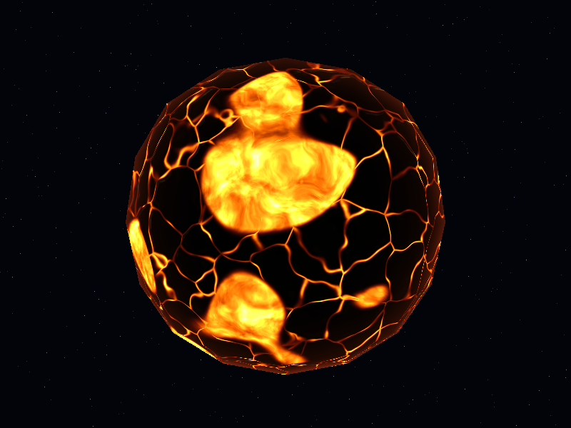 | 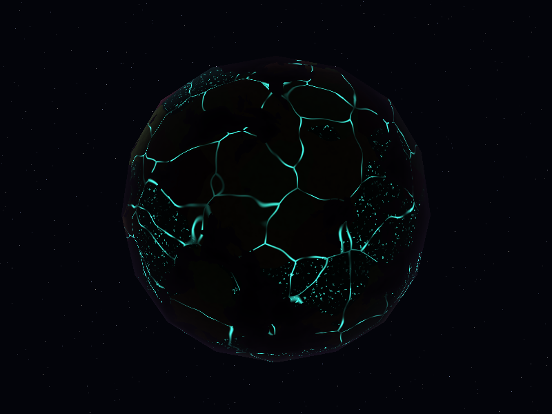 | 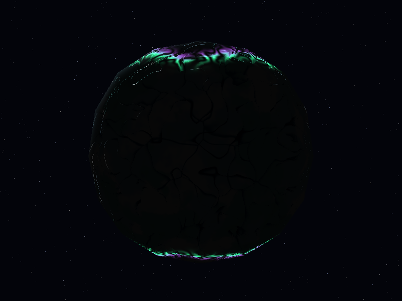 |

`day = smoothstep(-0.12, 0.18, dot(p, l))`. Las **luces de ciudad** se multiplican por `1 − day`,
por lo que solo aparecen en el lado nocturno (y las nubes las tapan). Lo mismo con la
bioluminiscencia de Nyx, el brillo extra de la lava y las auroras de Glacies.
*Parámetro:* tecla `L` las apaga; en `rocky.rs` el factor `3.0` de `city * night` controla su intensidad.

### Respuestas diferentes a la iluminación
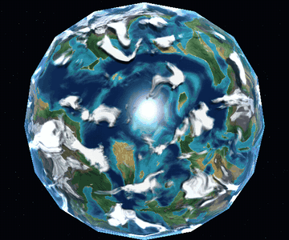

En Terra Nova los **océanos** tienen especular Blinn-Phong (`OCEAN_SHININESS = 90`) más un reflejo
del cielo por Fresnel; los **continentes** son mates (solo difuso con la normal del bump); el
**hielo** tiene un especular más suave (`30`). Al mover la luz (`Z`/`X`) el reflejo del sol recorre
el mar y desaparece al pasar sobre tierra. En Glacies la nieve es mate y el hielo/mar brillan; en Nyx
el mar tiene un reflejo rosado y la tierra usa *wrap lighting*.
*Parámetro:* `OCEAN_SHININESS` (más alto ⇒ reflejo más pequeño y nítido).

### Nubes procedurales
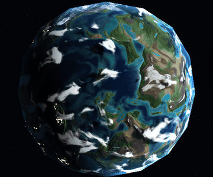

| Cobertura 0.20 | 0.50 | 0.85 |
|:---:|:---:|:---:|
| 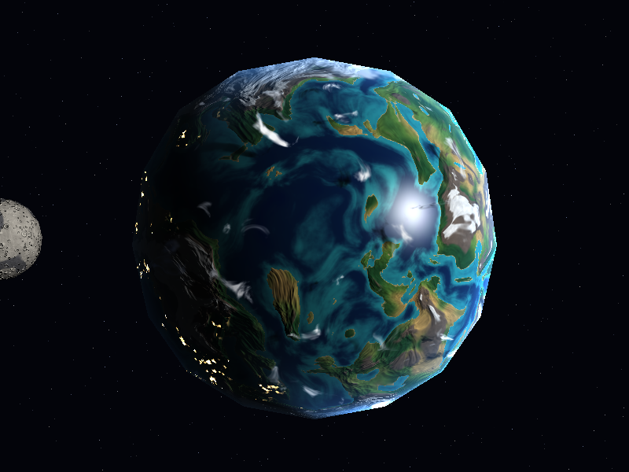 | 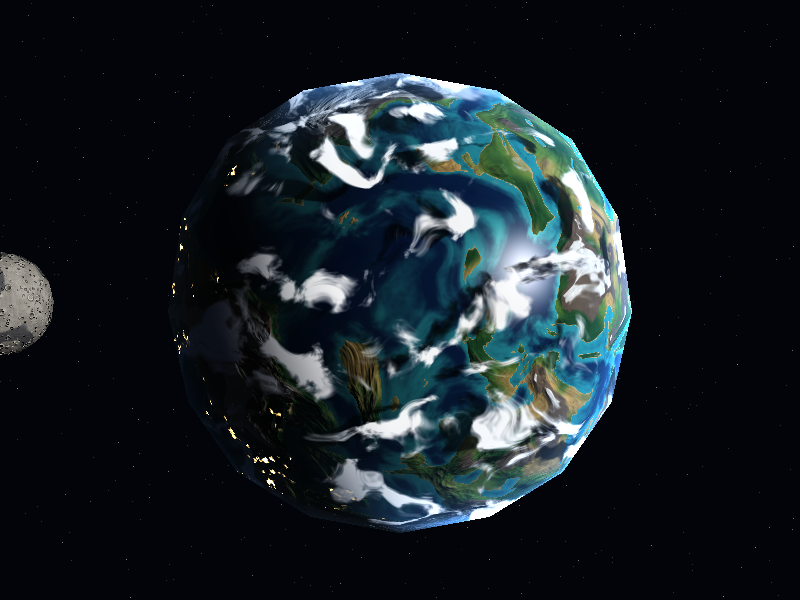 | 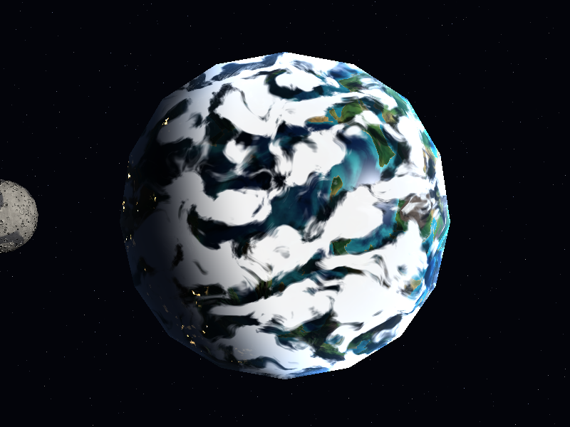 |

`cloud_density` muestrea un FBm estirado (`y·4`) con domain warping en una esfera que rota a
`CLOUD_SPIN = 0.11` rad/s mientras el terreno rota a `SURFACE_SPIN = 0.05`, por lo que se mueven
**independientemente** (en el GIF los continentes avanzan más lento que las nubes). La cobertura baja el
umbral del `smoothstep`. No hay otra esfera: las nubes se muestrean donde el rayo de vista cruza una
capa virtual a `CLOUD_HEIGHT` sobre la superficie.
*Parámetro:* `cloud_coverage` (teclas `[` `]`).

### Tormenta / vórtice localizado
| Con tormenta | Sin tormenta (`T`) |
|:---:|:---:|
| 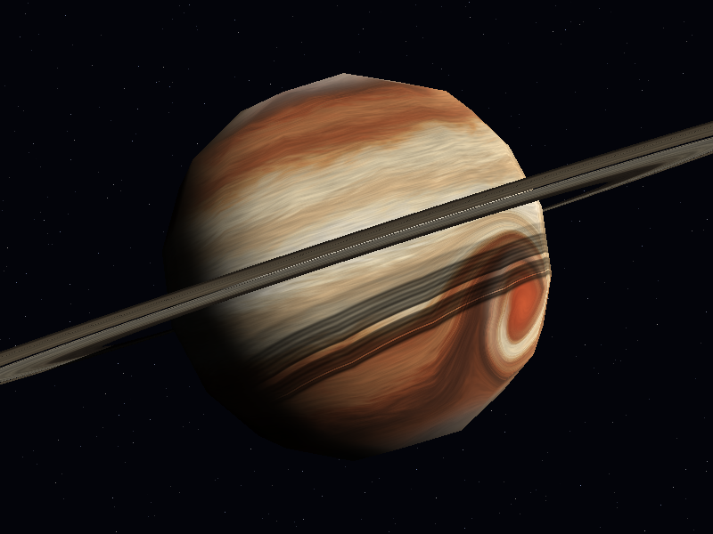 | 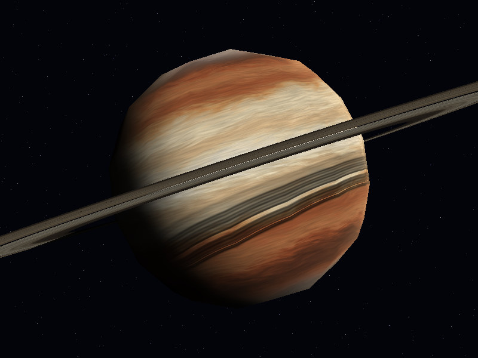 |

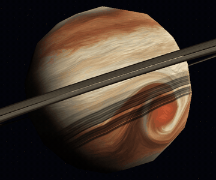

Se calcula la distancia angular `d` al centro de la tormenta y se **rota el punto de muestreo**
alrededor de ese eje con un ángulo `storm_strength · exp(−(d/R)²)`: máximo en el centro y nulo lejos.
Como las bandas se calculan con el punto rotado, las bandas vecinas **se curvan en espiral** alrededor
del ojo. Encima se pinta el núcleo rojizo y un anillo claro.
*Parámetro:* `storm_strength` (`N`/`M`): 0 deja las bandas rectas, 10 las enrolla varias vueltas.

### Relieve procedural (bump mapping)
| | Con bump | Sin bump (`B`) |
|---|:---:|:---:|
| Terra Nova |  | 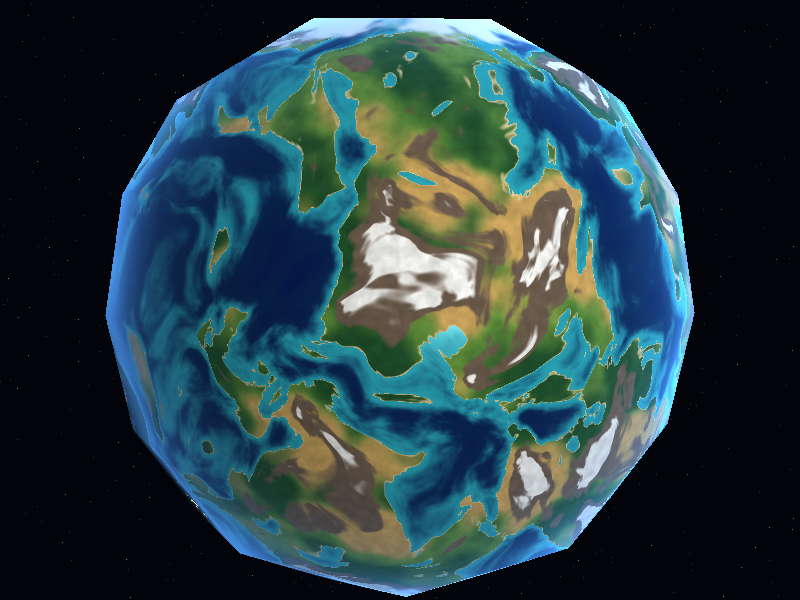 |
| Ignis | 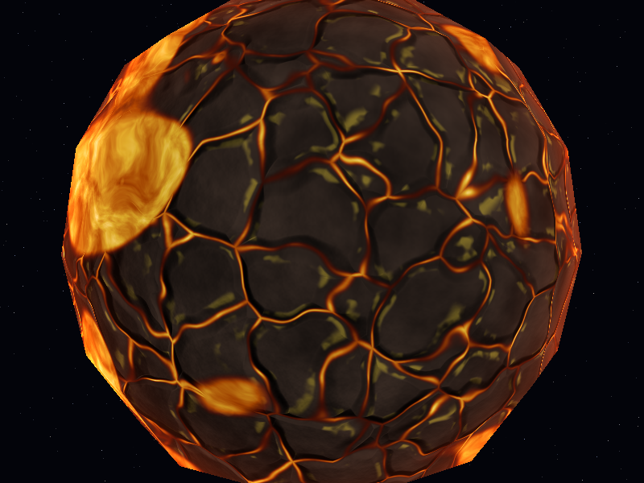 | 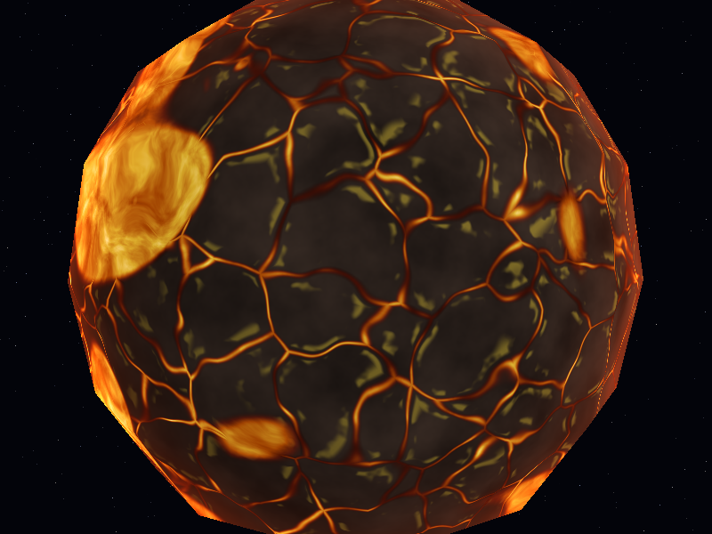 |
| Glacies | 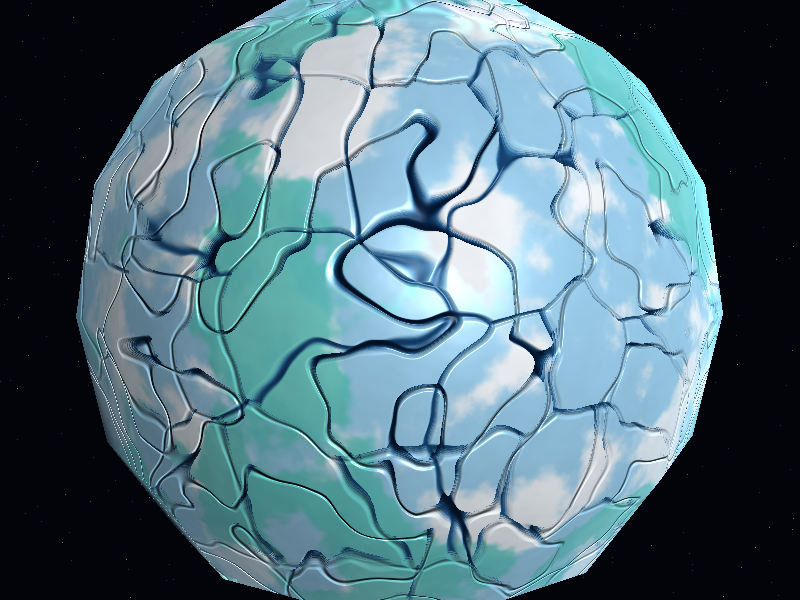 | 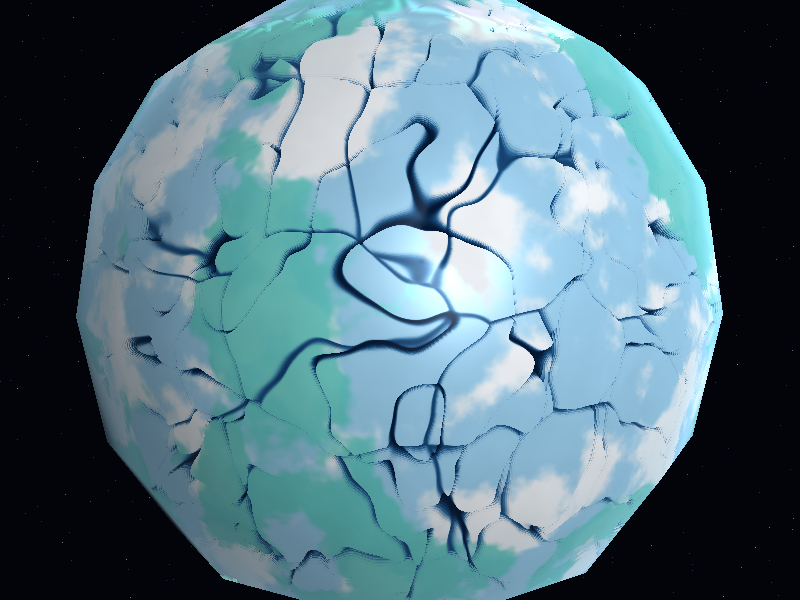 |

`common.rs::bump_normal` evalúa el campo de altura del shader en el punto y en dos puntos vecinos a
lo largo de la base tangente (T, B), obtiene el gradiente por diferencias finitas y lo resta a la
normal: `n' = normalize(n − k·(∂h/∂T·T + ∂h/∂B·B))`. Esa normal se usa en el difuso y el especular, así
las montañas, cráteres y placas responden a la dirección de la luz sin tocar los vértices.
*Parámetro:* `bump_strength` (`-`/`=`): 0 = plano, 4 = relieve exagerado.

### Parallax dependiente de la vista
| Con parallax | Sin parallax (`P`) |
|:---:|:---:|
| 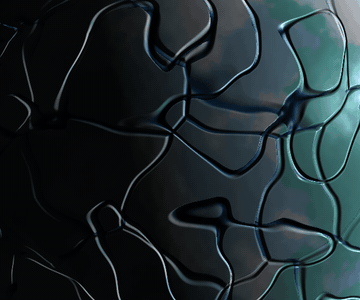 | 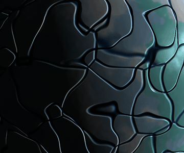 |

En Glacies (`ice.rs`) el campo de altura `height()` define grietas profundas. Por cada fragmento se
proyecta la dirección de vista sobre el plano tangente y se hace **steep parallax**: se avanza en
`PARALLAX_STEPS` capas en dirección opuesta a la vista hasta que el rayo queda bajo la superficie;
todos los colores se muestrean en ese punto desplazado. Al orbitar la cámara, el fondo de las grietas se
desliza respecto a sus bordes (sensación de profundidad); con `P` el patrón queda "pegado".
*Parámetro:* `parallax_scale` (`,`/`.`): más alto ⇒ grietas más profundas.

### Sombras de nubes
| Con sombras | Sin sombras (`H`) |
|:---:|:---:|
| 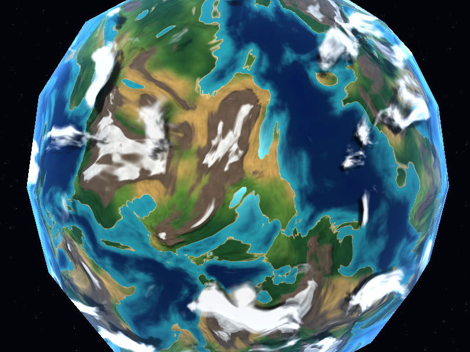 |  |

Desde cada punto de la superficie se lanza un rayo **hacia la luz** hasta la capa de nubes
(`ray_sphere_exit(p, l, 1 + CLOUD_HEIGHT)`) y se lee la densidad de nubes en ese punto: la sombra es
exactamente el patrón de las nubes, desplazado según la dirección de la luz (cerca del terminador se
alargan y se alejan más). Al mover la luz (`Z`/`X`, ver `anim_terra_luz.gif`) las sombras se
desplazan coherentemente.
*Parámetro:* `CLOUD_HEIGHT`: más alto ⇒ sombras más separadas de sus nubes.

---

## Rúbrica

| Criterio | Cómo se cumple |
|---|---|
| Criterio subjetivo | Seis mundos con paletas e identidad propias, vista de sistema completo, controles interactivos |
| Complejidad de shaders — 4 capas de color | Cada cuerpo combina **≥ 4 capas** (ver tablas de cada cuerpo: la estrella 5, rocoso 6, gaseoso 5, anillos 5, luna 4, extras 5) |
| Planetas extras — 3 | **Ignis** (lava), **Glacies** (hielo), **Nyx** (bioluminiscente) |
| Anillos en el gaseoso | Zephyr con anillos C/B/A, divisiones, sombras mutuas |
| Luna en el rocoso | Selene orbita a Terra Nova |

## Créditos
- Ruido: [`fastnoise-lite`](https://crates.io/crates/fastnoise-lite) (OpenSimplex2 y celular).
- Ventana: [`minifb`](https://crates.io/crates/minifb). Matemáticas: [`nalgebra-glm`](https://crates.io/crates/nalgebra-glm).
- Carga del OBJ: [`tobj`](https://crates.io/crates/tobj). Paralelismo: [`rayon`](https://crates.io/crates/rayon).
